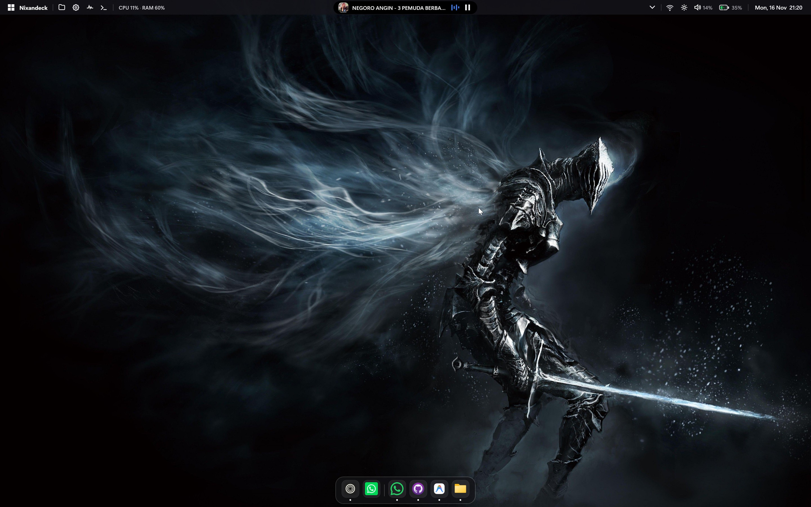
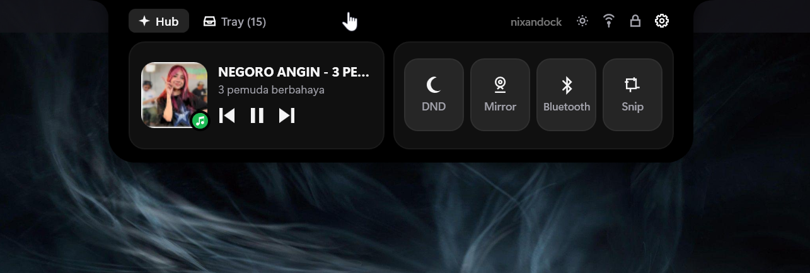
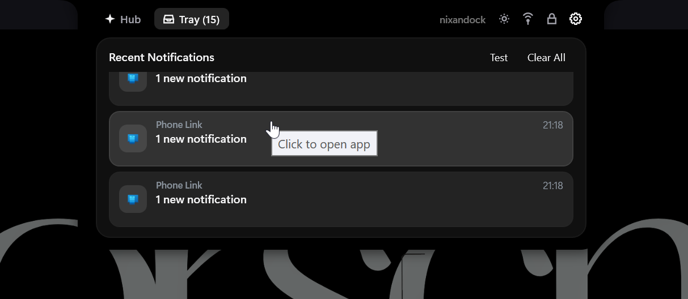
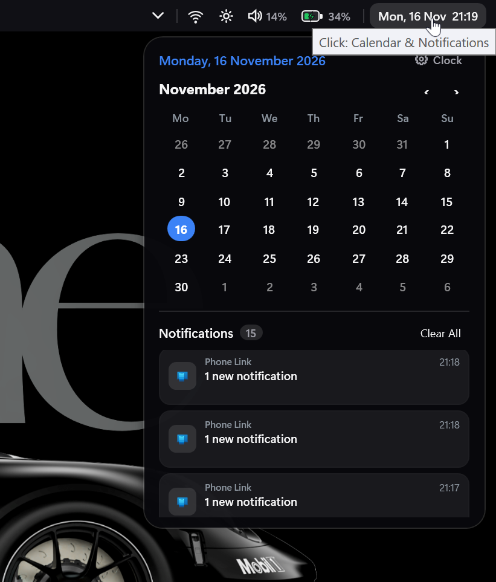
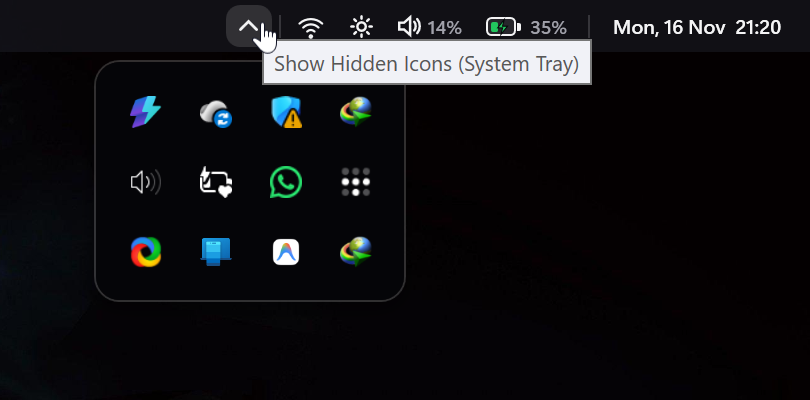
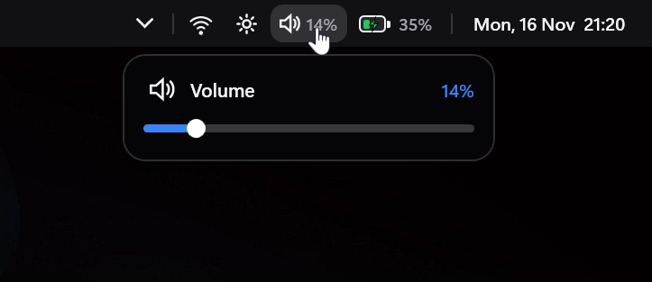
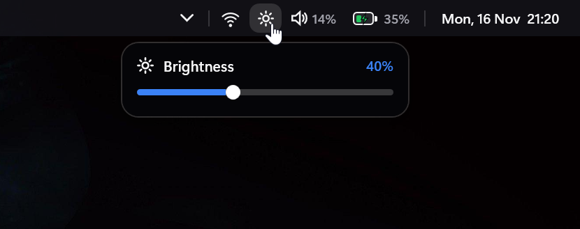
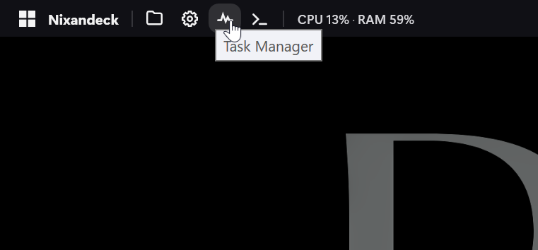

# NixanDeck (`nixandock`) — Dynamic Island, macOS Top Menu Bar & Liquid-Glass Dock for Windows 11

[-0078D4?logo=windows11&logoColor=white)](#)
[](#)
[](#)
[](#)

**NixanDeck (`nixandock`)** is an ultra-lightweight, native **macOS-inspired Shell Replacement**, **Dynamic Island / NotchNook alternative**, **Top Menu Bar**, and **Liquid-Glass Floating Dock** for **Windows 11**.

Built with **.NET 10**, **WPF**, **Win32 P/Invoke**, **DWM hardware acceleration**, and **WinRT APIs**, NixanDeck replaces the standard Windows 11 taskbar with a seamless macOS top bar, an interactive morphing **Dynamic Island**, and a responsive **Liquid-Glass Dock**—while keeping RAM usage low (~35–65 MB) and idle CPU under 0.5%.

---

## 📸 Screenshots



| Dynamic Island Control Hub | Notification Tray |
| :---: | :---: |
|  |  |

| Calendar & Notification Center | System Tray Flyout |
| :---: | :---: |
|  |  |

| Volume & Brightness Sliders | Top Bar Shortcuts |
| :---: | :---: |
|   |  |

---

## ✨ Key Features

### 1. 🏝️ Morphing Dynamic Island & Control Hub
Located at the center of the top bar, the **Dynamic Island** morphs smoothly using GPU-accelerated animations (`ExponentialEase`) across four states:
- **Idle State:** Minimalist horizontal hover indicator bar that stays out of your way.
- **Floating Media Pill:** Automatically appears as a sleek floating capsule when music or video is playing (Spotify, YouTube, Apple Music, browser media, VLC, etc.), displaying album art, track title, a live 4-bar audio visualizer, and instant Play/Pause toggle.
- **Notification Toast & Alarm Handle:** Expands seamlessly from the top bar with outward-pulled concave ear flares (`NotchNook` style) when new notifications arrive:
  - Full **Unicode & Emoji** support (powered by WinRT `UserNotificationListener` + direct Windows 11 `wpndatabase.db` UTF-8 sync for WhatsApp, Telegram, Discord, and desktop apps).
  - **Click-to-Open:** Clicking a toast or any notification item immediately brings the sender application's window to the foreground (or launches it).
  - **Windows Clock Alarm Handle:** Automatically detects Windows Clock alarms, extends display time, and provides a dedicated **Stop Alarm** action button.
- **Expanded Control Hub & Notification Tray:**
  - Opens on hover or click with two tabs: **Hub** (default) and **Tray** (automatically expanding vertically to display notification history).
  - **Hub Tab:** Features a rich **Media Player Card** (`Prev`, `Play/Pause`, `Next` with smart live-interpolated `+15s`/`-15s` timeline seeking for single YouTube videos and hardware media keys) alongside **4 Uniform Rounded-Square Quick Control Tiles**:
    - **DND** (Do Not Disturb toggle | Right-Click: DND / Focus Settings)
    - **Mirror** (Project / Display Switcher | Right-Click: Display Settings)
    - **Bluetooth** (Direct Bluetooth Radio On/Off toggle via `Windows.Devices.Radios` | Right-Click: Bluetooth Settings)
    - **Snip** (Screen Snip `ms-screenclip:` | Right-Click: Snipping Tool)
  - **Quick Header Shortcuts:** Night Light, Mobile Hotspot, Lock PC (`Win+L`), and Windows Settings.
  - **Tray Tab:** Clean, scrollbar-free notification drawer with a **Clear All** button and click-to-activate app switching.

### 2. 🖥️ macOS-Style Full-Width Top Menu Bar
- **Smart Desktop Work-Area Reservation (`30px`):** Reserves `30px` at the top of your primary display via `SHAppBarMessage` & `SPI_SETWORKAREA` so normal and maximized windows sit cleanly below the top bar without overlapping window title bars.
- **True Fullscreen Auto-Hide:** Automatically hides both the Top Bar and the Dock when you enter borderless fullscreen applications (games, YouTube fullscreen video, browser `F11`, media players) while keeping the Dock accessible in maximized creative apps (Affinity, Photoshop, etc.).
- **Left Bar Controls:**
  - **Windows Start Button** (smart open/close toggle)
  - **`nixandock` Brand Indicator**
  - **Icon-Only Quick System Shortcuts:** File Explorer, Windows Settings, Task Manager, and Windows Terminal
  - **Live CPU & RAM Usage Telemetry:** Real-time `CPU % · RAM %` indicator (click to open Task Manager)
- **Right Bar Controls:**
  - **Windows-Style System Tray Dropdown:** Compact chevron button that opens a frosted-glass grid flyout of background tray icons with full left-click and right-click context menu support.
  - **Real-Time Wi-Fi & Ethernet Status:** Automatically switches between a **3-bar Wi-Fi signal strength indicator** (powered by native `wlanapi.dll` real-time signal quality), an **Ethernet LAN icon**, or an **Offline warning icon**. Left-click toggles the Windows Network flyout (`ms-availablenetworks:`); right-click opens Network & Adapter settings.
  - **Brightness (Icon-Only):** Left-click opens a smooth hardware brightness slider (`\\.\LCD` IOCTL); scroll wheel adjusts screen brightness on the fly.
  - **Volume:** Left-click opens a modern volume slider popover; scroll wheel adjusts volume; right-click toggles mute.
  - **Dynamic Battery Indicator:** Real-time proportional fill bar that turns **green with a lightning bolt** when charging/on AC power, **red** when battery is `<= 20%`, and crisp white on normal battery discharge.
  - **Day, Date & Clock (`ddd, dd MMM  HH:mm`):** Clicking the clock opens a **Windows 11-style Calendar & Notification Center Flyout** featuring a full monthly calendar grid (`‹` / `›` month navigation), a quick **Clock** button to launch the Windows Clock/Alarms app (`ms-clock:`), and a clickable notification list.

### 3. 🧊 Bottom Floating Liquid-Glass Dock
- **Liquid-Glass Aesthetics:** Translucent dark acrylic/glass surface with a specular highlight border (`CornerRadius="16"`) and compact `36×36` icon tiles.
- **Gaussian Hover Magnification:** Smooth, real-time macOS-style icon magnification as your cursor glides across the dock.
- **Automatic Taskbar Pinned Apps Import:** Automatically imports your existing Windows Taskbar pinned shortcuts and Store/UWP apps on first launch.
- **Multi-Window Instance Support:** Displays every open window visible in `Alt+Tab` (e.g., multiple Windows Terminal or File Explorer instances) so no window is ever hidden.
- **Direct Win32 Window Toggle:** Clicking an active/maximized app cleanly minimizes it (`SW_MINIMIZE`), and clicking it again restores it without losing its maximized state.
- **Smart Auto-Hide:** Automatically slides out of the way when a window overlaps the dock area and reveals itself when hovering near the bottom edge of the screen.

### 4. 🛡️ Built-In Safety & Watchdog Protection
- **Emergency Taskbar Hotkey (`Ctrl + Alt + Shift + R`):** Instantly toggles the native Windows 11 taskbar on or off at any time.
- **Right-Click Restore:** Right-clicking any empty space on the Top Bar provides a **Restore Default Windows & Exit** option that immediately restores the native Windows taskbar and desktop work area.
- **Dedicated Watchdog Process (`NixanDeck.Watchdog.exe`):** Runs silently alongside the main app (`--pid <PID>`). Even if `WinMacShell` is forcibly terminated via Task Manager (*End Task*), the Watchdog immediately restores the native Windows taskbar (`Shell_TrayWnd`) and resets the screen work area.
- **Automatic Windows Startup Integration:** Registers automatically in **Windows Settings > Apps > Startup** via the MSIX `windows.startupTask` extension.

---

## 📦 Installation Guide

### Option 1: Install from Release ZIP (Recommended)

1. Download **`NixanDeck-Windows11-x64.zip`** from the [Releases](../../releases) page (or from the `publish/` folder).
2. Extract the `.zip` archive to any folder on your computer. You will see three files:
   - `Install.bat`
   - `NixanDeck.cer`
   - `NixanDeck.msix`
3. Double-click **`Install.bat`**:
   - The script will automatically request **Administrator privileges** (click **Yes** on the UAC prompt).
   - Step `[1/2]` installs the self-signed `NixanDeck.cer` security certificate into your machine's `TrustedPeople` certificate store so Windows 11 trusts the MSIX package.
   - Step `[2/2]` automatically opens **`NixanDeck.msix`** in the Windows App Installer.
4. Click **Install** (and check *Launch when ready*) in the Windows App Installer window.
5. **Startup Configuration:** Once installed, **NixanDeck (nixandock)** is automatically added to **Windows Settings > Apps > Startup** so it starts with Windows.

---

### Option 2: Build from Source (For Developers)

#### Prerequisites
- **OS:** Windows 11 (x64, Build `10.0.19041.0` or newer)
- **SDK:** [.NET 10 SDK](https://dotnet.microsoft.com/download/dotnet/10.0)
- **Developer Mode:** Enabled in *Windows Settings > System > For developers* (for registering the dev package)

#### 1. Clone & Build (Debug)
```powershell
git clone https://github.com/nurikhsanuddin/nixandeck.git
cd nixandeck

dotnet build WinMacShell.sln --configuration Debug
```

#### 2. Register Dev Package & Run
```powershell
powershell -ExecutionPolicy Bypass -File .\Scripts\Register-DevPackage.ps1
```
You can now launch **NixanDeck (nixandock)** from the Windows Start Menu or run `.\src\WinMacShell\bin\Debug\net10.0-windows10.0.19041.0\WinMacShell.exe`.

#### 3. Build Shareable Release Package (`.msix` + `.zip`)
To build a self-contained `win-x64` release, generate a self-signed certificate, package and sign `NixanDeck.msix`, and create `publish/NixanDeck-Windows11-x64.zip`:
```powershell
powershell -ExecutionPolicy Bypass -File .\Scripts\Build-ShareableRelease.ps1
```

---

## ⌨️ Shortcuts & Quick Interactions

| Action | Trigger |
| :--- | :--- |
| **Toggle Native Windows Taskbar (Emergency Failsafe)** | `Ctrl + Alt + Shift + R` |
| **Restore Default Windows & Exit** | Right-click empty area on Top Bar → *Restore Default Windows & Exit* |
| **Open Control Hub / Notification Tray** | Hover or click the center Dynamic Island |
| **Open Monthly Calendar & Notification Center** | Click the Date & Time clock at top-right |
| **Adjust Volume / Mute** | Click Volume button (slider), scroll wheel on Volume button, or right-click to Mute |
| **Adjust Screen Brightness** | Click Brightness icon (slider) or scroll wheel on Brightness icon |
| **Open Wi-Fi / Network Settings** | Left-click Wi-Fi icon (flyout) or right-click for Network menu |
| **Pin / Unpin Apps on Dock** | Right-click any app icon on the Dock → *Pin to Dock* / *Unpin from Dock* |

---

## 🔍 Search Topics & Keywords

`windows-11` `macos-dock` `dynamic-island` `notchnook` `notchnook-windows` `windows-11-dock` `windows-11-topbar` `macos-menubar-windows` `liquid-glass` `windows-shell-replacement` `wpf` `dotnet-10` `nixandock` `nixandeck`

---

## 📄 License

Distributed under the MIT License.
